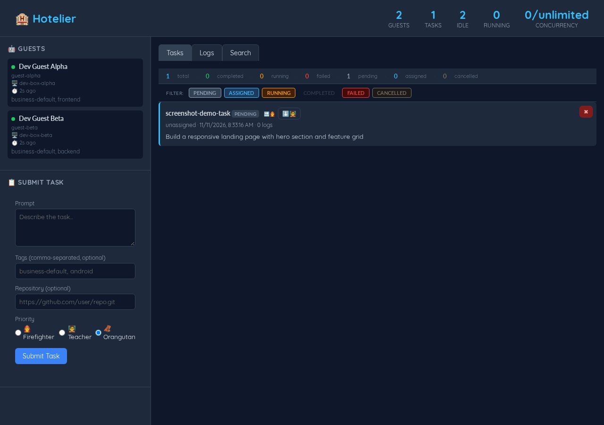

# Hotelier

Ephemeral YOLO guest queue — autonomous AI development infrastructure.

***Warning***: this is alpha-grade software (read: made for myself, all bugs included). Use at your own risk.

## Overview

Hotelier orchestrates ephemeral AI guests ("machines") that register, receive tasks, execute them against target repositories, stream logs, and submit results. Guests are configured entirely via YAML config files.

## Screenshots



## Architecture

```
┌──────────────┐    WebSocket     ┌───────────────┐
│  Check-In    │◄────────────────►│    Guest      │
│  Host        │  JSON-RPC 2.0    │  (any machine │
│  :8080       │                  │   running the │
│              │                  │   guest CLI)  │
└──────────────┘                  └───────────────┘
  ├── REST API                      ├── guest.yaml
  ├── Web UI                        ├── Register
  ├── Task Queue                    ├── Execute tasks
  └── Guest Registry                ├── Stream logs
                                    └── Submit results
```

## Quick Start

```bash
make build

# Copy example configs and edit to suit
cp config/server.example.yaml config/server.yaml
cp config/guest.example.yaml config/guest.yaml

./bin/hotelier    # Server on :8080
./bin/guest       # Guest (runs tasks via the pi AI agent)
```

## Configuration

Sample configs are provided in `config/`:

| File | Description |
|------|-------------|
| `config/server.example.yaml` | Check-In Host (server) configuration |
| `config/guest.example.yaml` | Guest configuration |

Copy the examples to `config/server.yaml` and `config/guest.yaml`, then edit as needed.

### Server (`config/server.yaml`)

```yaml
host: "0.0.0.0"
port: 8080
read_timeout: 30
write_timeout: 30
max_log_size: 1048576
task_timeout: 3600
heartbeat_interval: 30
silence_timeout: 180
max_guests: 0
max_concurrent_tasks: 0
```

| Field | Description | Default |
|-------|-------------|--------|
| `max_concurrent_tasks` | Cap on how many tasks the host is willing to run at any moment (`0` = unlimited). Used when no `concurrency_schedule` is set; the schedule takes precedence otherwise. | `0` |
| `concurrency_schedule` | Daily schedule of concurrency caps. Each entry (`{ at: "HH:MM", concurrency: N }`) takes effect at that wall-clock time and holds until the next entry; the last entry of the day holds through midnight to the first. In an entry `0` is a real cap and pauses all new work — the opposite of `max_concurrent_tasks: 0`, which means unlimited. The resolver keeps the two apart: it reports "no cap" as `config.ConcurrencyUnlimited` (`-1`), which no configuration can carry, so a returned `0` always means "start nothing". | — |
| `schedule_timezone` | IANA zone name the schedule's `at` times are interpreted in, so boundaries follow the wall clock across DST. The server binary embeds the tz database (`time/tzdata`), so a zone name resolves even in the scratch container image, which ships no `/usr/share/zoneinfo`. | `"UTC"` |
| `log_retention_days` | How many days of task logs the prune sweep keeps. Date directories older than today minus this many days are removed at startup and on the cleanup tick; the current day and any in-window day are left completely alone, and `queue_dir` is never touched. Following the `max_guests` convention, `0` disables pruning. | `14` |

**The HTTP API performs no authentication and there is no TLS.** A server
bound to `0.0.0.0` serves the dashboard, the guest registry and the task logs
to anyone who can reach the port. Bind `host` to `"127.0.0.1"` on a single
machine, or keep it reachable only through a proxy that authenticates;
whatever the bind, the API must not be exposed to untrusted networks.

Worked example — cap of 2 from 07:00 and 4 from 23:00, Sydney time (DST-aware):

```yaml
max_concurrent_tasks: 0
schedule_timezone: "Australia/Sydney"
concurrency_schedule:
  - at: "07:00"
    concurrency: 2
  - at: "23:00"
    concurrency: 4
```

Malformed schedules (unparseable zone, malformed or duplicate `at`, negative
`concurrency`) are reported as configuration errors at load time; a bad edit
is rejected by the config watcher and the running server keeps the last good
configuration. A schedule the resolver cannot read falls back to
`max_concurrent_tasks`, so a deployment that leans on the schedule overnight
should set that key to a non-zero cap to fail closed rather than open. An `at`
that falls inside a daylight-saving gap (Sydney has no 02:00–03:00 on the first
Sunday of October) takes effect at the first instant after the gap.

**How the cap is enforced.** A task is admitted only while fewer tasks are in
flight (`ASSIGNED` or `RUNNING`) than the cap in force. The check happens where
assignments are decided, so every path that can hand out work — a guest polling
for a task, a new submission, a rerun, a reconcile — obeys the same rule. The
cap gates *starting* work only: when it drops, tasks already running finish
normally; nothing is cancelled or paused. When it rises — on a reload, or at a
schedule boundary, which the server notices within seconds with no new task and
no guest poll — the queue drains to the new cap on its own.

**Changing the cap live.** The dashboard's concurrency field, or
`POST /api/concurrency` with a body of `{"cap": 3}` — `{"cap": "unlimited"}`
to lift the cap, `0` to pause new assignments — sets the live cap directly
(issue #264). It takes effect at once, the way a reload does, and is never
persisted to disk. It rules until the next boundary of the concurrency
schedule, when the scheduled shrink or expansion takes over again; with no
schedule it rules until the next config reload — which clears it and returns
authority to the file — or a restart. While it rules, the status surface
names the source as `manual override`.

A queue the cap is holding back looks different from a pool with no matching
guest, in the four places an operator reads:

- the log: `task <id> held back by the concurrency cap: 2 in flight, cap 2
  (queue is waiting on the schedule, not on guest availability)`, stated once
  per change of state rather than once per poll; a pool problem instead logs
  `task <id> pending: no available guest with tags [...]`
- the task: `held_reason` on a pending task names the cap and what is in
  flight, and clears as soon as the task is assigned
- `/api/health`: `in_flight` and `concurrency_cap` (the latter `"unlimited"`
  when no cap is in force) say the same thing at a glance
- the dashboard: a concurrency stat in the header — an editable cap field with
  a Set button, labelled `N in flight · next 23:00 → 4` — so night mode reads
  as night mode rather than as an idle system, and the cap in force can be
  changed where it is read (issue #264)

The same picture is served on the endpoint the dashboard polls, as
`concurrency` on `/api/guests`:

```json
{
  "cap": 2,
  "source": "concurrency_schedule at \"07:00\"",
  "in_flight": 2,
  "waiting_on_cap": 3,
  "next_change": {"at": "23:00", "cap": 4, "timezone": "Australia/Sydney"}
}
```

`cap` is the enforced number the orchestrator measures its counts against —
the same one `/api/health` states, and the one the next assignment decision
obeys (`"unlimited"` when no cap is in force) — and `source` names the
schedule entry — or `max_concurrent_tasks` — it came from, so the value is
traceable to the config without opening the file. `in_flight` counts the
`ASSIGNED` and `RUNNING` tasks the cap is measured against, and
`waiting_on_cap` the pending tasks there is no room for — the queue beyond
whatever room the cap has left. `waiting_on_cap` above zero with idle guests
means the queue is longer than the cap's room, which is the case a flat
"nothing is running" cannot tell apart from a dead pool. The count is
arithmetic on the queue and the room, not a per-task verdict: a queue that
also waits on guests with matching tags still counts while it exceeds the
room, and which of the two holds a given task is what that task's own
`held_reason` says. `next_change` is `null` while the cap will not move — no
schedule, or a schedule whose entries all carry the same cap; otherwise it
names the instant the enforced cap actually flips at, so an entry inside a
DST gap is quoted at the transition and one inside a fall-back repeated hour
at its next occurrence. `source` and
`next_change` are resolved from the schedule directly, so immediately after a
boundary they can name the new cap up to one 15-second sync tick before `cap`
and the counts move to it.

With neither `max_concurrent_tasks` nor a schedule set — the default, and every
deployment that predates this feature — there is no cap and assignment behaves
exactly as it did before.

### Guest (`config/guest.yaml`)

```yaml
url: "wss://hotelier.example.com:443/ws"
id: "guest-1"
name: "Dev Guest #1"
tags:
  - "business-default"
  - "frontend"
heartbeat_interval: 15
task_timeout: 1800
working_dir: "/tmp/hotelier"
log_level: "info"
```

| Field | Description | Default |
|-------|-------------|--------|
| `url` | Full WebSocket URL of the Check-In Host (`ws://` or `wss://`). Scheme defaults to `ws://` or `wss://` based on mTLS config if omitted. | — |
| `id` | Identity the guest registers under. Set it to something stable per machine (typically the hostname) and a process restart keeps the same identity in the registry; deployments template it. See [Guest identity](#guest-identity). | generated: `guest-<8 random hex>` |
| `working_dir` | Base directory for task execution | `"/tmp/hotelier"` |
| `log_level` | Logging level (`debug`, `info`, `warn`, `error`) | `"info"` |
| `home_copies` | Home paths copied into every task's namespace jail (issue #201). Entries are relative to the guest's home directory: directories are copied recursively, files (e.g. a skill's dot-file config) are copied with their content and mode; entries that do not exist on this guest are skipped. Absolute paths and `..` components are rejected. | built-in set: `.pi`, `.certs`, `.forgejo-gitconfigs`, `.tokens` |

Example with mTLS:

```yaml
url: "wss://hotelier.example.com:443/ws"
client_cert: "/home/user/.certs/client.crt"
client_key:  "/home/user/.certs/client.key"
```

Example without mTLS:

```yaml
url: "ws://localhost:8080"
```

### Guest identity

The `id` is the guest's identity in the registry, and the registry keys every
assignment off it. When it is unset the guest generates one at process start
(`guest-<8 random hex>`), which keeps a reconnection from colliding with the
registration a dead process left behind — at the cost of a new identity on
every restart.

Setting a stable `id` (issue #253) keeps that identity across restarts, so
work assigned to the machine stays associated with it. A stable id is only
correct because the guest also says, on every registration, whether this is a
reconnection or a fresh process:

- **Reconnection** (same process, socket dropped and re-established): the
  server reconciles the guest against the task queue, so a guest still running
  a task keeps it.
- **Fresh process** registering an id the registry already holds: the guest
  holds nothing, so the server drops the stale reference and leaves the guest
  IDLE. It does not hand back a task the previous process was given, and the
  stuck-task probe re-queues that task within `task_assignment_timeout`.

Two live processes sharing one configured id are last-writer-wins: the second
registration takes the identity, and the first guest's task is re-queued once
its heartbeat goes silent. Give one id to one machine.

**Retiring a stale registration.** A registration left behind by a dead
process is retired automatically once the guest has been silent for
`silence_timeout` (stale-guest cleanup fails its task and removes the entry),
by the guest unregistering on a graceful shutdown, or by the next fresh
registration under the same id — which clears the task reference immediately.

## Task Submission

Via REST API:

```bash
curl -X POST http://localhost:8080/api/tasks \
  -H 'Content-Type: application/json' \
  -d '{
    "prompt": "Implement feature X",
    "tags": ["business-default"]
  }'
```

Or through the web UI dashboard.

### Title and reference URL

Tasks may carry an optional `title` (a short human-readable description)
and `url` (a reference link, e.g. to a pull request). Neither is required;
a submission without them behaves exactly as before. Both are persisted
across restarts and returned by the task-list and task-detail endpoints.

### Deduplication

Tasks may carry an optional `dedup_key`. When a task is submitted with a
`dedup_key` that matches a currently **pending** task, the new submission is
silently squelched — no new task is created — and the existing task is
returned with HTTP 200 and `"dedup": true`. Assigned, running, and finished
tasks do not block a new submission, and tasks without a `dedup_key` are
never deduplicated.

```bash
curl -X POST http://localhost:8080/api/tasks \
  -H 'Content-Type: application/json' \
  -d '{
    "prompt": "Deploy service 42",
    "dedup_key": "deploy-service-42"
  }'
# 200 { "task": { ...existing pending task... }, "dedup": true, "dedup_key": "deploy-service-42" }
```

## API Endpoints

| Method | Path | Description |
|--------|------|-------------|
| `GET` | `/api/tasks` | List all tasks in queue processing order |
| `POST` | `/api/tasks` | Submit a new task |
| `GET` | `/api/tasks/:id` | Get task details |
| `POST` | `/api/tasks/:id/priority` | Change a PENDING task's priority; body `{"priority": "firefighter\|teacher\|orangutan"}` |
| `GET` | `/api/tasks/:id/download` | Download the task's whole log trace as JSONL |
| `GET` | `/api/tasks/search` | Search task output text: `q` (required), `status` (optional), window via `days=N` or `from`/`to` dates |
| `POST` | `/api/tasks/filter` | Set or clear the task preference filter; body `{"filter": "<text>"}`, empty string clears, values past 256 bytes rejected with `400` |
| `GET` | `/api/guests` | List connected guests (UID, host, state, tags), the claim counters and the live concurrency picture |
| `GET` | `/api/guests/:id` | Get guest details |
| `POST` | `/api/concurrency` | Set the live concurrency cap; body `{"cap": N}` (whole number, `0` pauses new work) or `{"cap": "unlimited"}`; honoured until the next schedule boundary; returns the concurrency picture |
| `GET` | `/api/health` | Health check |
| `GET` | `/metrics` | Prometheus scrape endpoint: live server state as gauges, plus task-transition counters and histograms |
| `WS` | `/ws` | WebSocket (JSON-RPC) |

`/api/tasks/search` reads matches through the date-partitioned log store,
so searching output text never requires downloading whole traces. Lookback
is enforced server-side: with no window supplied the last 5 days are
searched, and a window wider than 14 days is rejected with `400` and an
explanatory body — an explicit rejection rather than a silent clamp, so a
client never believes it searched further than it did. The 14-day cap is
independent of log retention pruning: dates already pruned simply yield no
matches, and pruning never widens a window. Days are the server's calendar
days, the same ones the log store names its partitions by.

Two response fields say how complete an answer is. A search reads traces as
a stream and costs at most 64 MiB of decompressed log text per request, and
at most 200 matches come back — both bounds are the server's, not the
query's, so one request can neither read nor hold the whole window — and
`truncated: true` says the scan stopped at one of those bounds and newer
hits in the window exist that are not listed (the scan walks oldest
first, so what it omits is what comes after the cut).
`partial: true` says some partition or trace could not be read; the rest of
the window was scanned normally and the reason went to the server log, so a
partial answer is not a failed one.

Each match carries the task's *current* title and status from the queue, plus
two lines of context either side. The `status` filter matches against that
current status only: a trace whose task the server has since forgotten comes
back with empty `title` and `status` and never satisfies the filter, so a
client searching history should retry without it.

Reach worth stating plainly: like every other route here, this endpoint is
unauthenticated, and unlike `/api/tasks/:id/download` — one known task per
request — it greps every task's output in the window at once and returns the
ID, title and status of each hit. An operator who wants that aggregate read
restricted must front the port themselves; nothing here distinguishes one
caller from another.

The **task preference filter** (issue #281) is a live operator control for
when inference is tight. The dashboard's *Preference* field filters the task
list by a case-insensitive substring of each task's repository, title,
prompt, persona or tags, and persists the text to the address bar as a
`#filter=...` fragment — the fragment is the field's only persistence path.
**Prioritise** sends it to the backend (the `POST` endpoint above, a write
with no read half), where pending tasks matching the substring drain before
the rest; once no pending task matches, normal queue semantics apply — the
filter is a preference, never a suppression. **Clear** resets field,
fragment and backend. Like the concurrency cap the filter is held in memory
only, so a server restart clears it.

Reach worth stating plainly: like every other route here this endpoint is
unauthenticated too, and it is the one route that changes scheduling for
everyone at once — a single `POST` reorders the pending drain for every
guest and every dashboard, and stands until someone clears it. Because
that effect is global and lasting, the endpoint also refuses forged
browser requests: a request whose `Origin` names another *origin* — scheme
or host differing from this server's own — or which reports
`Sec-Fetch-Site: cross-site`, is answered `403`, so neither a third-party
page an operator happens to visit nor a page served over plain HTTP under
this server's own hostname can bend or reset the order from the operator's
own browser (in fetch-metadata terms "site" is scheme-blind, so the Origin
match binds the scheme too: https arrives only where TLS was terminated —
here or at an edge announcing it with `X-Forwarded-Proto`). Non-browser
clients carry neither header and are judged as before. It leaves no
mark on any task, and the applied state is not broadcast to other open
dashboards (a reload there restores the field from the fragment but not
the applied mark, so the page cannot tell them the order is bent), so the one log
line naming the filter is the record of when the order was bent — and,
since nothing here distinguishes one caller from another, not of by whom. A
deployment that must keep the write to operators enforces that at the
network edge; the fetch-metadata check above covers the one path that
does not pass through the edge — the operator's own browser. The filter
text is capped at 256 bytes — a fragment of a repository name or title has
no use past that — and an oversized value is refused rather than stored.

`/api/guests` also carries a `stats` object. The two action counters,
`cancelled_while_running` and `cancelled_before_start`, cover every `task.cancel`
the guest confirms — revocations of re-queued claims and host-requested cancels
alike — while `ack_refusals` is the recurrence signal for a guest running work
the host has already closed (issue #252), so a non-zero action counter on a busy
host is ordinary cancellation rather than a regression.

### Metrics

`GET /metrics` answers scrapes in the [Prometheus exposition
format](https://prometheus.io/docs/instrumenting/exposition_formats/), gathered
from the live state at scrape time — no background goroutine, and no second copy
of a number another package owns. The exact encoding is negotiated from the
scraper's `Accept` header; Prometheus defaults and plain `curl` get the text
format. Like `/api/health` it is unauthenticated, and a scrape that fails to
gather is logged on the server and answered with a generic 500 rather than an
error dump.

| Metric | Type | Labels | Meaning |
|--------|------|--------|---------|
| `hotelier_tasks` | gauge | `status` = `PENDING`, `ASSIGNED`, `RUNNING`, `COMPLETED`, `FAILED`, `CANCELLED` | Tasks the queue is holding, by status |
| `hotelier_guests` | gauge | `state` = `DISCONNECTED`, `REGISTERED`, `IDLE`, `RUNNING` | Guests connected to this server, by state |
| `hotelier_tasks_in_flight` | gauge | — | Tasks in flight: `ASSIGNED` or `RUNNING` |
| `hotelier_concurrency_cap` | gauge | — | Maximum number of tasks allowed in flight; `+Inf` when no cap is in force |
| `hotelier_tasks_held_by_cap` | gauge | — | `PENDING` tasks whose last assignment attempt was refused, i.e. carrying a hold reason (the count lags a rising cap until the next poll considers each task) |
| `hotelier_tasks_submitted_total` | counter | — | Tasks accepted into the queue |
| `hotelier_tasks_deduplicated_total` | counter | — | Submissions squelched against an already-pending task with the same dedup key |
| `hotelier_tasks_finished_total` | counter | `outcome` = `completed`, `failed`, `cancelled` | Tasks that reached a terminal state, by outcome |
| `hotelier_tasks_requeued_total` | counter | — | Tasks re-entering the pending queue after `RequeueTask` or a guest declining |
| `hotelier_task_queue_wait_seconds` | histogram | — | Seconds a task spent in the pending queue before an assignment; for a requeued task the window opens at the requeue, so its earlier run is never counted as waiting |
| `hotelier_task_duration_seconds` | histogram | — | Seconds between a task's assignment and its terminal transition (a task cancelled before assignment counts in `finished_total` but contributes no duration) |

Label values are the strings the state machines use internally (`TaskStatus.String`
and `GuestState.String`), and every label is a fixed enumeration: no task ID,
guest ID, persona name or repository URL ever reaches this endpoint, so the
number of series stays bounded whatever the queue does.

**The cap is never published as a number when it is not in force.** Internally
the "no cap" sentinel is deliberately negative (`config.ConcurrencyUnlimited`,
`-1`) so it can never be mistaken for a count of tasks; on `/metrics` that case
reads as `+Inf`. A graph of `hotelier_concurrency_cap` therefore shows a flat
line at the configured ceiling whenever a cap is scheduled, and a series pushed
off the top of the panel — night mode lifted, nothing held back — when it is
not. `-1` never appears.

The counters and histograms count **transitions** — what happened — while the
gauges above read **state** — what is happening. They are incremented in the
orchestrator, at every point a status changes — the lifecycle methods plus the
auto-assign path in `TryAssignNext` — so the counts cannot drift from the
state, and no server call site can be forgotten. Both histograms use buckets
spanning one second to two hours, deliberately: these are agent runs, and the
default Prometheus bucket set (topping out around ten seconds) would put every
task in `+Inf`; the ceiling sits above the one-hour `task_timeout` default so
even a timed-out task lands in a finite bucket.

**Counters and histogram observations reset when the process restarts.** That
is how Prometheus counters work, and `rate()` accounts for the resets; nothing
here persists them, because `queue_dir` persists unprocessed tasks only and a
persisted counter would need a recovery path nothing else in this server has.
The queue keeps terminal tasks until the process restarts, so
`hotelier_tasks{status="COMPLETED"}` and friends likewise return to zero while
the on-disk queue carries the work itself.

Scrape config sample:

```yaml
scrape_configs:
  - job_name: hotelier
    static_configs:
      - targets: ["hotelier.example.com:8080"]
    metrics_path: /metrics
    scheme: http
```

## Tags

Guests declare capability tags at registration. Tasks specify required tags for routing:

- `business-default` — Standard development (default)
- `android` — Android-specific tasks
- Custom tags — Any capability your guest supports

## Deployment

### Container (Server Only)

Hotelier ships a multi-stage `Containerfile` for building the **server-side** binary as a container image. The guest is intentionally **not** containerized — agentic coding agents expect direct access to a machine's filesystem, shell, and tools (the `pi` agent runs a persistent RPC subprocess that expects a real host environment).

#### Build

```bash
make image
```

This uses `podman` to build the image. The build has two stages:

1. **builder** — a `golang:1.26-trixie` image that compiles the `hotelier` binary with `CGO_ENABLED=0`, `-trimpath`, and `-ldflags "-s -w"`.
2. **runtime** — a `scratch` image containing only the compiled binary, the `web/` static files, and the `/var/log/hotelier` directory.

The `scratch` image is the minimal possible base — it has no shell, no package manager, no DNS resolver, and no CA certificates. The server binary is statically linked so it runs without libc. This means the container cannot perform DNS lookups or TLS verification for outbound connections; it is suitable for serving the web UI and accepting WebSocket connections from guests on the local network.

#### Run

```bash
podman run -d --name hotelier \
  -p 8080:8080 \
  -v /path/to/config:/etc/hotelier:Z \
  hotelier:latest
```

#### Configuration

The server reads its config from `/etc/hotelier/server.yaml` inside the container. Mount a host directory containing your config:

```bash
# On the host
cp config/server.example.yaml /path/to/config/server.yaml
# Edit /path/to/config/server.yaml as needed

# Run the container
podman run -d --name hotelier \
  -p 8080:8080 \
  -v /path/to/config:/etc/hotelier:Z \
  hotelier:latest
```

##### Volume Mounts

| Mount | Purpose |
|-------|--------|
| `/etc/hotelier` | Config files (read-only recommended) — mount a host directory containing `server.yaml` |
| `/var/log/hotelier` | Task log persistence — set `log_dir` in config to enable; mount a host directory |
| `/var/lib/hotelier/queue` | Queue persistence — set `queue_dir` in config to enable; mount a host directory |

Example with read-only config:

```bash
podman run -d --name hotelier \
  -p 8080:8080 \
  -v /path/to/config:/etc/hotelier:Z,ro \
  hotelier:latest
```

##### Environment Variables

No environment variables are required. The server is configured entirely through the YAML config file.

#### Task Log Persistence

Set `log_dir` in `server.yaml` to persist task logs to the mounted volume:

```yaml
log_dir: "/var/log/hotelier"
```

Logs are stored in a date-partitioned structure:

```
/var/log/hotelier/
  2026-05-10/
    task-abc123/
      logs.jsonl
    task-def456/
      logs.jsonl
  2026-05-11/
    task-ghi789/
      logs.jsonl
```

Each `logs.jsonl` file contains one JSON object per line (JSONL format), with fields:
`task_id`, `line`, `level`, `timestamp`.

Task logs are pruned after a retention window so the tree cannot grow into
the volume that hosts it. `log_retention_days` sets the window in days
(default `14`); date directories older than today minus that many days are
removed at startup and on the cleanup tick, and the sweep logs what it
pruned (dirs, file count, bytes reclaimed). Set `log_retention_days: 0` to
keep logs forever. The sweep only ever removes date-named directories, so
`queue_dir` — even pointed at the same tree — survives regardless of a
persisted entry's age.

The web UI includes a **Logs** tab for browsing persisted task logs.

It also includes a **Search** tab over that persisted output. A query and a
lookback window go to `GET /api/tasks/search` (see [API
Endpoints](#api-endpoints)); the matches come back with the task, the date and
a little context, each linking to the log view of the task it came from. The
lookback field defaults to the server's own 5-day default and is sent as typed:
how wide a window is allowed is the server's decision, so a window beyond the
14-day cap is reported back as the server's rejection rather than quietly
clamped in the page.

Run with log persistence:

```bash
podman run -d --name hotelier \
  -p 8080:8080 \
  -v /path/to/config:/etc/hotelier:Z,ro \
  -v /path/to/logs:/var/log/hotelier:Z \
  hotelier:latest
```

#### Queue Persistence

Set `queue_dir` in `server.yaml` to remember unprocessed tasks across server
restarts. Without it, the queue is in-memory only and a restart drops every
pending, assigned and running task.

```yaml
queue_dir: "/var/lib/hotelier/queue"
```

Unprocessed tasks are stored as JSON files, one per task, in per-status
subdirectories:

```
/var/lib/hotelier/queue/
  pending/
    task-abc123.json
  assigned/
    task-def456.json
  running/
    task-ghi789.json
```

When the server starts, persisted tasks are restored to the queue. Pending
tasks re-enter as they were; assigned and running tasks re-enter as PENDING
(their original prompt, tags, priority, title, URL and creation time are
preserved) and are (re-)assigned afresh when guests reconnect — a running
task is effectively re-started from the beginning. Terminal tasks
(completed, failed, cancelled) are not persisted.

Run with queue persistence:

```bash
podman run -d --name hotelier \
  -p 8080:8080 \
  -v /path/to/config:/etc/hotelier:Z,ro \
  -v /path/to/queue:/var/lib/hotelier/queue:Z \
  hotelier:latest
```

##### Health Check

The container includes a built-in health check that pings the server's own binary every 30 seconds. Check status with:

```bash
podman inspect --format='{{.State.Health.Status}}' hotelier
```

### Guest Deployment

Guests run **natively on machines** — they are not containerized. Each guest machine needs:

1. The `bin/guest` binary (built via `make build`)
2. A `config/guest.yaml` pointing to the Check-In Host
3. Go installed (for the `pi` agent subprocess)
4. `pi` CLI installed (`go install github.com/mariozechner/pi-coding-agent@latest`)
5. `git` installed (for cloning repos)

```bash
# On the guest machine
make build
cp config/guest.example.yaml config/guest.yaml
# Edit config/guest.yaml with your server address
./bin/guest
```

### Task Isolation (namespace jail)

Every task runs inside its own **namespace jail** (issue #51): user, mount
and pid namespaces created by `unshare(1)`, the same mechanism
bubblewrap/Flatpak, rootless podman and the AI-agent CLIs use. The guest
re-execs itself under `unshare --map-root-user --mount --pid --fork`;
the in-namespace child bind-mounts the host's real `/usr` read-only,
mounts a scoped `/proc` and a fresh `/dev` (device nodes bound from the
host, a private devpts and `/dev/shm`), copies the required `/etc` files
and the guest's home paths per-task, and pivots the root to the jail.
The home copy set is configured in the guest config (`home_copies`,
issue #201): entries are paths relative to the guest's home directory, and
may be directories (copied recursively) or files (copied with their
content and mode). When the field is omitted or empty, the built-in
default set applies (`~/.pi`, `~/.certs`, `~/.forgejo-gitconfigs`,
`~/.tokens`). Before exec'ing pi it drops into a nested (child) user
namespace as a non-root uid (issue #198): in that namespace pi holds no capabilities, so
the jail's read-only mounts can no longer be remounted or unmounted from
inside. The task's working directory is the single
read-write path, mounted at the fixed in-jail path `/task`; everything
else is read-only or a private copy, so writes inside the jail never
reach the host. The jail is removed when the task completes.

Tasks that need a **nested container runtime** (podman) carry the
`podman` tag (issue #236). Such a task's jail additionally maps the
guest user's subuid/subgid block (`unshare --map-root-user --map-auto`,
util-linux >= 2.41.6) and the nested-namespace drop writes a multi-entry
map mirroring it instead of the single-UID entry, so image layers can be
unpacked across the range. Two version floors are involved. The
*functional* one is 2.40, and it is the drop's, not the flag's:
`--map-auto` itself is older, but the drop passes the mirrored ranges as
repeated `--map-users`/`--map-groups` arguments and
[unshare(1)](https://man7.org/linux/man-pages/man1/unshare.1.html) only
accumulates ranges across multiple occurrences from 2.40 — on earlier
versions each occurrence overwrites the previous one and only the last
range would be mapped. The *supported* floor is higher for security
reasons (see below). In that mode the command is uid 0 inside the
*nested* namespace but still holds no capabilities in the outer one —
the issue #198 property is unchanged. Tasks without the tag keep the
single-UID mapping unchanged.

Range-mapped tasks need three host-side prerequisites, none of which the
plain jail path requires (all are provisioned by config management):
`/etc/subuid` and `/etc/subgid` entries for the guest user (without them
`--map-auto` maps no range and podman will not work); the `uidmap`
package, because from 2.40 `unshare` writes a range map through
`newuidmap`/`newgidmap` unless it is already euid 0
([unshare(1)](https://man7.org/linux/man-pages/man1/unshare.1.html));
and a `/etc/passwd` entry for the guest user, which those helpers need
to resolve its subuid ownership. A tagged task on a host missing any of
them fails loudly at spawn rather than running mis-mapped. In range mode
the command is uid 0 in the nested namespace, so podman there selects
the rootful engine and wants a writable container store; where that
store lives inside the jail is guest provisioning work, not jail code.

The supported util-linux floor for range-mapped tasks is **>= 2.41.6**
(**>= 2.42.3** on the 2.42 series). Nothing functional needs it — 2.40
behaviour is enough for the map itself — but
[CVE-2026-78408](https://lwn.net/Articles/1103311/), the missing
`O_CLOEXEC` file-descriptor leak in `unshare(1)`/`nsenter(1)`, is fixed
only in those releases: the 2.40 series stopped at 2.40.4 and never
received it. (The advisory's other half — closing the `cgroup.procs` fd
after `nsenter --join-cgroup` — needs 2.42.4 and never reached the 2.41
branch; it does not apply here, because the jail runs `unshare` and
never joins a cgroup.) The jail is an unusual `unshare` consumer in that the last
`exec` before the task code runs is an `unshare` `exec` (the chain is
`unshare` → `guest -jail-child` → `unshare` → task command, and
`--kill-child` makes `unshare` hold a `pidfd`), so an fd leaking across
that `exec` lands inside the jail. The pin is a host-provisioning
matter like the three prerequisites above, and is tracked there; a guest
host on 2.40.x does not satisfy it.

Jail isolation is always enabled and cannot be disabled. No capabilities
are required — the only prerequisite is kernel support for unprivileged
user namespaces (`kernel.unprivileged_userns_clone=1` on Debian). The
guest fails at startup if it cannot create them.

## License

MIT
